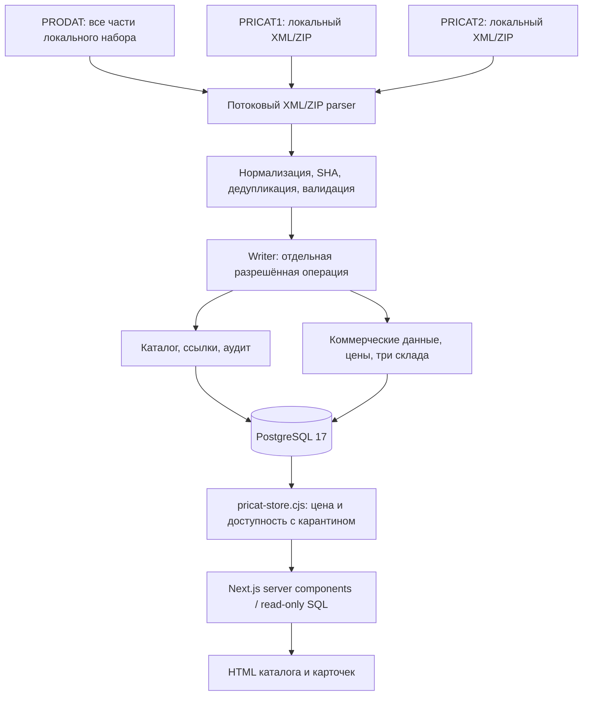
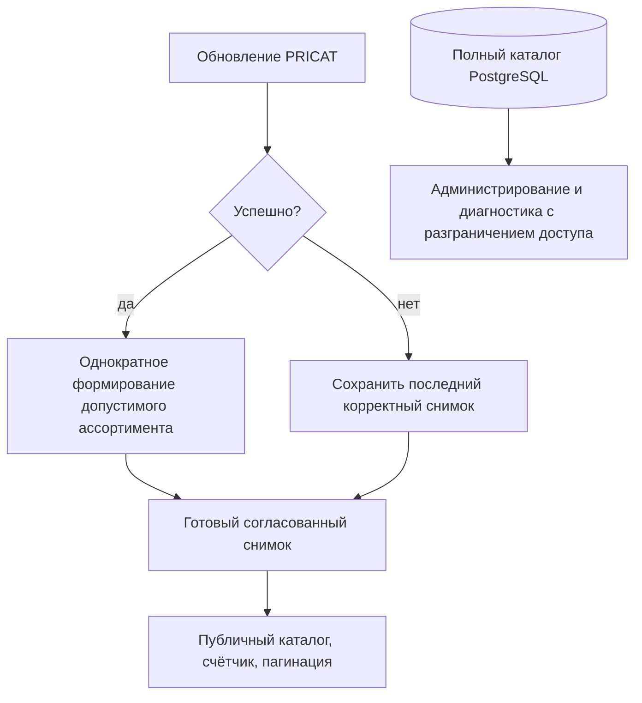
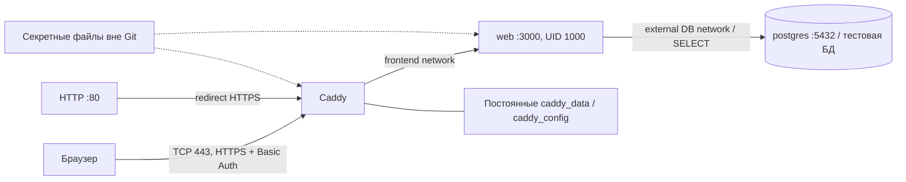

# Технический паспорт: архитектура

> Область паспорта: код изучен на ветке разработки `codex/storefront-docker` (коммит `2f20c29`).
> Этот PR — только документация от `origin/main@ccdd8e9`. Каталогов `web/` и
> `deploy/storefront/` в этой базе main нет; упоминания этих путей относятся
> к указанной отдельной ветке разработки, а не к файлам данного PR. Их код сюда не переносится.

Срез исходников: **2f20c290bf1f0b0d0c129e9cf7228f8c77cc03a4**, ветка
`codex/storefront-docker`, база витрины — `feat/storefront-mvp`.
Дата паспорта: **2026-10-29**. Документация подготовлена отдельно от рабочего checkout.

## Как читать паспорт

- **КОД** — реализовано в указанном срезе, проверено чтением исходников/тестов.
- **ПРАВИЛО** — подтверждено спецификацией или явными решениями владельца; наличие правила не означает наличие UI.
- **ЭКСПЛУАТАЦИЯ** — факт из завершённого развёртывания 2026-10-29, а не новая проверка VPS при написании паспорта.
- **ВРЕМЕННО / MVP** — работающий согласованный промежуточный вариант, не конечное бизнес-правило.
- **УТВЕРЖДЁННАЯ ЦЕЛЬ** — согласованное требование, которое ещё не реализовано.
- **ПЛАН** — предлагаемая работа по реализации; не обещание срока и не новое бизнес-решение.
- **ВОПРОС** — требуется решение; нельзя самостоятельно превращать предположение в правило.

Навигация: [БД](DATABASE.md), [бизнес-правила](BUSINESS_RULES.md),
[импорт](IMPORTS.md), [разработка и эксплуатация](DEVELOPMENT.md),
[статус и вопросы](ROADMAP.md), [инструкции агентам](../AGENTS.md).

Дополнение от 2026-10-29: полностью сверено с [канонической записью GitHub issue №1](https://github.com/stron111-web/elektrikamarket/issues/1)
(создана/обновлена 2026-10-29, комментариев на момент сверки нет).
Код по-прежнему рассматривается на 2f20c29; дополнение не меняет этот срез.
Вопросы видимости, трёх складов, PRICAT-снимка и границ MVP определяются этой
утверждённой записью. Она не разрешает автоматически менять код, БД или VPS.

Фактическое поведение определяет код; бизнес-контракт — подтверждённые решения.
При расхождении документируем оба и согласуем изменение. Старые разделы
[спецификации](../elektrikamarket_import_spec.md) неоднородны по версии:
реестр расхождений находится в ROADMAP, а не исправляется молча.

## Назначение и границы

**КОД:** нормализованный каталог одного поставщика, пакетные импортёры PRODAT/PRICAT,
read-only витрина Next.js. Браузер не разбирает XML, сайт не обращается к XML на запрос.
Нет реализованного цикла покупки: корзины, заказов, оплаты, доставки, кабинета,
админки и пользовательских ролей магазина.

**КОД:** Prisma описывает схему и историю SQL-миграций. Runtime импортёров и витрины
использует `postgres` (postgres.js), а не Prisma Client.
`prisma7.config.ts` — фактическое нестандартное имя конфигурации, не
`prisma.config.ts`; для Prisma CLI при необходимости указывать
`--config prisma7.config.ts`. Это не разрешение запускать миграции.

## Поток данных

FTP discovery/download, расписание и отдельный постоянно работающий Import Worker —
**ПЛАН**, их нет в развёрнутом Compose. Не путать импортный CLI с автоматической загрузкой.

## Структура репозитория

| Путь | Ответственность |
|---|---|
| `prisma/schema.prisma` | 16 прикладных моделей, enum, связи, Decimal |
| `prisma/migrations/` | Три существующие SQL-миграции; история, не инструкция повторного применения |
| `prisma7.config.ts` | Пути Prisma и URL из окружения |
| `scripts/init-system-data.ts` | Создание отсутствующих stock1/2/3 и settings; **записывает БД** |
| `scripts/import/prodat.cjs` | Потоковый XML/ZIP, кодировки, структура и дедупликация |
| `prodat-normalize.cjs`, `prodat-import.cjs` | Каталог, staging, публикация и аудит |
| `prodat-barcodes.cjs`, `prodat-barcode-store.cjs` | EAN и защита ручных записей |
| `prodat-references.cjs`, `prodat-reference-store.cjs` | Фото, документы, analog/related |
| `prodat-slug.cjs`, `prodat-repair-slugs.cjs` | Создание slug; отдельный repair существующих slug |
| `pricat.cjs`, `pricat-normalize.cjs`, `pricat-import.cjs` | Чтение, нормализация и публикация PRICAT |
| `scripts/import/pricat-store.cjs` | Writer коммерческих данных и **общая** SQL-логика цены/доступности |
| `scripts/import/*.test.cjs` | Unit и integration; часть тестов создаёт временные БД |
| `web/app/` | App Router, каталог, карточка, ошибки, health endpoint |
| `web/lib/data.ts` | Пул, read-only транзакции, поиск/фильтры/страницы |
| `web/lib/availability.cjs` | Композиция SQL существующего readAvailableStocks без копирования правил |
| `web/components/photo.tsx` | Фото с заглушкой при ошибке |
| `web/tests/` | SQL-эквивалентность доступности и HTTP smoke |
| `web/Dockerfile`, `web/next.config.ts` | Production standalone |
| `deploy/storefront/` | Web/Caddy Compose, роль SELECT, запуск и локальная проверка |
| `docker-compose.yml` | Локальный Compose; не конфигурация работающего VPS PostgreSQL |

Имена модулей без полного пути в таблице относятся к `scripts/import/`.
Незакоммиченные `scripts/deploy/` основного checkout не входят в срез 2f20c29:
этот паспорт не обещает их наличие в чистом clone и не включает их в коммит.

## Runtime и зависимости

**КОД:** Node.js 24; root CommonJS и преимущественно `.cjs` импортёры.
Витрина — TypeScript, Next.js App Router, React. Root и `web/` имеют отдельные
package.json и lockfile. Фактически проверенный образ: Next.js 16.4.0,
React 19.3.0; semver-диапазоны package.json шире, воспроизводимость задают lockfile
и digest базового образа. Prisma объявлена в root 7.x.

Парсер использует sax, unzipper, iconv-lite; SQL — postgres.js; окружение — dotenv.
AdmZip используется, в частности, для тестовых ZIP. Наличие зависимости не
означает отдельный сервис. Root postinstall вызывает `prisma skills sync`;
это побочный эффект установки, не часть торговли.

## Запрос витрины: временная реализация MVP

**ВРЕМЕННО / КОД:** оба режима согласованы для MVP 11.10.2026. Описанный ниже
расчёт на запросе не является утверждённой конечной архитектурой.

1. Параметры каталога нормализуются: q до 120 символов, category до 200, допустимые
   положительные page/brand; размер страницы 24.
2. Транзакция REPEATABLE READ READ ONLY получает каталог/бренды и множество кандидатов.
3. В режиме `stock` SQL доступности применяется **до** LIMIT/OFFSET и счётчика.
   `all` включает неархивированные товары без доступности.
4. Для страницы выбираются авторитетная цена и допустимые склады общими функциями.
5. Карточка получает изображения/документы и упаковку **источника выбранной цены**.

Поиск — параметризованный ILIKE по name, supplierCode, vendorNumber с экранированием
LIKE-метасимволов. Фильтр категории включает потомков. Это не полнотекстовый поиск
и не поиск по EAN/ETIM. API health проверяет процесс, не запрос к БД.
Пул ограничен четырьмя соединениями, default_transaction_read_only включён.

## Утверждённая целевая архитектура — ещё не реализована

По [issue №1](https://github.com/stron111-web/elektrikamarket/issues/1) от 29.10.2026 после успешного обновления PRICAT
нужно один раз сформировать готовый к показу ассортимент. Публичный каталог,
счётчик и пагинация должны читать этот результат без повторного расчёта
доступности всех товаров на каждом запросе. При неудачном импорте сохраняется
последний корректный снимок; его нельзя заменять нулевыми остатками.

Схема выражает **требование**, не существующие сервисы/таблицы. Выбор между
снимком, materialized view и кешем, транзакционность публикации и корректная
инвалидация требуют проектирования и тестов. SQL CTE MATERIALIZED внутри одного
запроса текущего MVP не является таким постоянным снимком.
Изменения manual/locked, защитной наценки и карантина также нужно учесть при
проектировании инвалидации, не теряя действующих правил продажи.

«Все товары» остаётся диагностическим режимом тестового стенда; публичному
покупателю окончательной витрины он не предназначен. Полный ассортимент остаётся
в БД и должен быть доступен администрированию с отдельным разграничением доступа.
Текущий Basic Auth тестового сайта не является готовой моделью этих прав.
Следующий согласованный шаг — диагностика времени SQL/HTML/изображений на VPS,
затем проектирование снимка отдельной задачей; здесь диагностика не выполнялась.

## Тестовое развёртывание

**ЭКСПЛУАТАЦИЯ:** test.elektro-24.ru, VPS 168.113.208.94, Ubuntu 24.04;
основной домен магазина — elektrikamarket.ru, но он не является адресом этого релиза.
DNS: NIC.RU как регистратор elektro-24.ru, AdminVPS DNS, без Cloudflare в данной схеме.

Web/Caddy — отдельный Compose; PostgreSQL 17.11 — существующий контейнер.
Web/PG не публикуют host ports; Caddy публикует TCP 80/443; SSH 22 сохранён.
Caddy защищает весь сайт, добавляет noindex; owner/developer — аккаунты периметра,
не учётные записи или роли внутри приложения.

Образ содержит standalone server, static, public и внешний `pricat-store.cjs`.
Runtime read-only, cap_drop ALL для web, tmpfs для временных файлов/кеша.
`start.cjs` проверяет имя роли и конкретной тестовой БД; секрет не вшит в образ.
Расширение read-only набора таблиц требует отдельной проверки необходимости.

**Ограничение временного MVP:** точный SQL-подсчёт наличия выполняется на запросе;
утверждённый предварительный снимок пока отсутствует. Исторические ~5 секунд
из web/README относятся к локальному измерению 11.10, не к SLA или замеру VPS.
Фото/документы загружаются по внешним HTTP(S) URL, без медиа-хранилища и proxy.
Basic Auth сайта не защищает внешние ссылки. Защита HTTPS/noindex на периметре
не является пользовательской авторизацией магазина.
