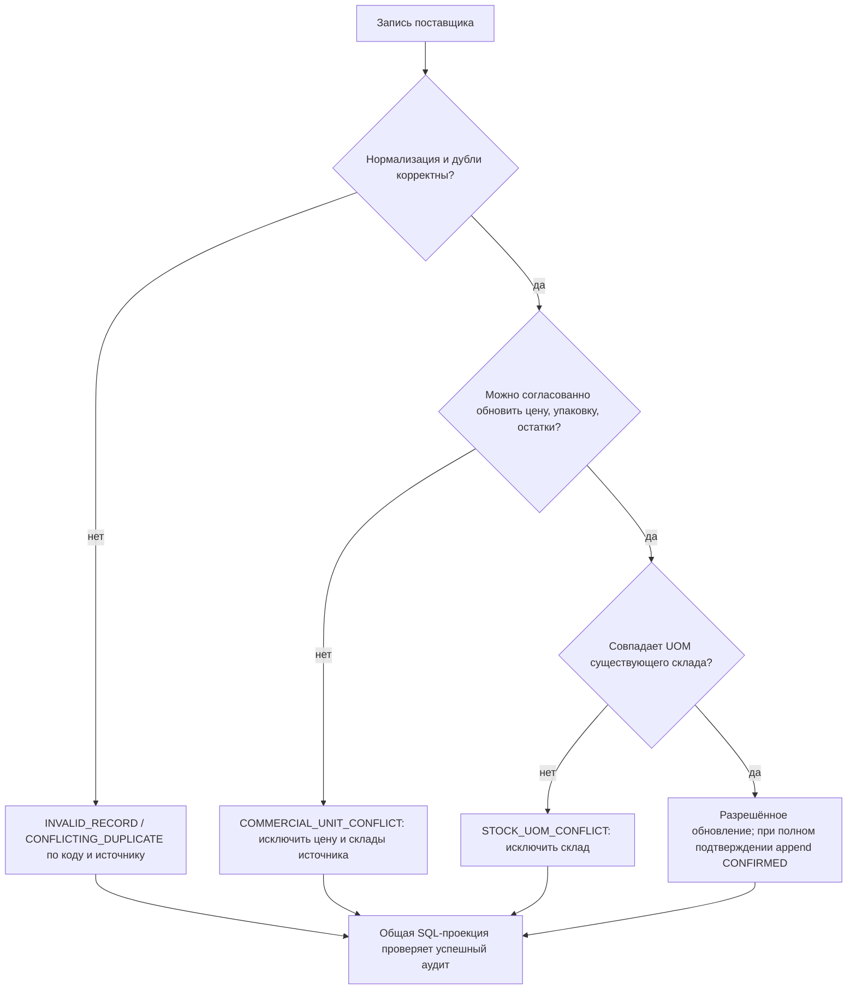

# Технический паспорт: бизнес-правила

Срез/обозначения: [ARCHITECTURE](ARCHITECTURE.md).
Основные доказательства: [спецификация, §18](../elektrikamarket_import_spec.md),
[PRICAT contract](../scripts/import/pricat-import.md),
[normalizer](../scripts/import/pricat-normalize.cjs),
[SQL-проекции](../scripts/import/pricat-store.cjs),
[тесты](../scripts/import/pricat.test.cjs). Спорные исторические формулировки —
[ROADMAP](ROADMAP.md).

## Единая цена

**ПРАВИЛО + КОД:** один товар имеет одну цену продажи независимо от склада.
Приоритет среди **допустимых** источников:

1. MANUAL.
2. PRICAT2.
3. PRICAT1.

Нулевой stock2 не понижает приоритет PRICAT2. Не выбирать минимум/максимум
цен складов. Не усреднять источники, не брать закупочную цену другого склада.

**ПРАВИЛО:** RetailPrice — базовая розничная цена; Price2 — подтверждённая владельцем
закупочная цена с НДС. CustPrice сохраняется служебно. MRC/BSP/Availability_MRC
сейчас не участвуют в расчёте. Закупочную Price2 клиенту не раскрывать.

**КОД: фильтр источника** — неархивированный Product, непустой commercial.uom,
stored retailPrice>0, currency и retailCurrency обе RUB (без учёта регистра),
для поставщика price2>0; MANUAL допускается без положительной закупочной цены.
Результат должен быть >0 и <10^12. Требуется settings id=1 с неотрицательной наценкой.
Карантинные контексты/ошибочные источники исключаются до выбора приоритета.
Не всякое наличие строки MANUAL означает допустимую ручную цену.

## Защитная наценка

**ПРАВИЛО + КОД:**

```text
если RetailPrice < Price2:
    цена = round(Price2 × (1 + protectiveMarkupPercent / 100), 2)
иначе:
    цена = RetailPrice
```

Default настройки — 30%; это default схемы/инициализации, не утверждение о
неизменности настройки всех окружений. Пример: 90.00 при закупке 100.00 и 30%
даёт 130.00. При равенстве розницы и закупки защитное повышение не применяется.

Normalizer использует BigInt для точных расчётов и half-up округления до копеек.
Сохраняет исходные поля и protectiveRuleApplied в price.rawData, а вычисленную
розницу — в retailPrice. SQL чтения также применяет **текущую** настройку:
для незаблокированной импортной цены с маркером protectiveRuleApplied берётся
исходный raw RetailPrice, чтобы смена процента не ждала повторного импорта.

**Важное различие:** manual/locked запрещает перезапись сохранённых значений.
SQL чтения всё равно защищает цену ниже положительной Price2, включая MANUAL/locked,
не меняя строку БД. Не интерпретировать lock как разрешение продажи ниже закупки.
Для MANUAL без price2 защитное сравнение не срабатывает.

## Упаковки и единицы

**ПРАВИЛО + КОД:**

- UOM — единица продажи; QTY — количество таких единиц; цена дана за эту единицу.
- ItemsPerUnit — содержимое единицы продажи, ItemsPerUOM — текстовая единица содержимого.
- NMP — целая упаковка. Нельзя делить цену на ItemsPerUnit, умножать остаток на
  ItemsPerUnit, автоматически превращать упаковки в штуки или дробить упаковку.
- Multiplicity — отдельная кратность покупки у поставщика, не размер упаковки.
  Хранятся decimal и исходная строка; пустое не приравнивать к 1.
- PartnerUOM может отличаться от основного UOM; автоматической конвертации нет.
- Упаковка карточки берётся из commercialData источника выбранной цены, не PRODAT.
- Остатки разных UOM не суммировать.

**ПРАВИЛО, НЕ РЕАЛИЗОВАНО В UI:** будущий ввод количества должен учитывать Multiplicity.
Сейчас нет корзины/оформления, поэтому наличие отображения упаковки не означает
проверку количества заказа.

## Доступность и три склада

| Склад | Источник количества |
|---|---|
| stock1 | PRICAT1.QTY |
| stock2 | PRICAT2.QTY |
| stock3 | PRICAT1.SupOnhandDetail.PartnerQTY |

SumQTY не используется. PRICAT2.PartnerQTY не создаёт дополнительный склад.

**КОД:** readAvailableStocks возвращает только quantity>0, неархивированные товар
и склад, совместимую `stock.uom === sale.uom`, допустимую единую цену и отсутствие
действующего карантина источника/склада. Проверка `quantity > 0` напрямую неверна.
SQL цены и складов выполняется в одном statement для согласованного snapshot.
readSaleOffers группирует одну цену и допустимые склады без конвертации единиц.

Отсутствующие QTY/PartnerQTY и отсутствующий код не обнуляют прежние значения.
Явный 0 сохраняется как ноль; NULL означает неизвестность. Product не удаляется.
Свежесть оставленных остатков ограничена не TTL, а фактическими импортами;
**ВОПРОС:** согласовать срок допустимого устаревания перед коммерческим запуском.

Каталог по умолчанию «В наличии» фильтрует доступность до пагинации.
`availability=all` показывает неархивированные товары, включая недоступные.
«Цена отсутствует» означает отсутствие коммерческих данных и успешных PRICAT-issues;
«Цена не подтверждена» — сведения есть, но цена отклонена торговой проекцией.
Архивный товар не выдаётся; отсутствие в свежем файле само по себе не архивирует.

## Карантин — состояние из аудита, а не один флаг



| Случай | Сохранение и влияние |
|---|---|
| Разные записи одного кода в одном PRICAT-источнике | Все варианты диагностируются; не выбирать «последний». В quarantine допустимые коды продолжают обновляться |
| INVALID_RECORD / CONFLICTING_DUPLICATE | Незаблокированный остаток этого источника становится NULL, прежнее значение в аудите; locked сохраняется, но не продаётся |
| STOCK_UOM_CONFLICT | Входной UOM склада отличается от сохранённого: строка сохраняется, склад исключается даже при другой/ручной цене |
| COMMERCIAL_UNIT_CONFLICT | Изменение UOM/ItemsPerUnit/ItemsPerUOM не удаётся совместить с защищённой ценой/контекстом или удержанными остатками: источник сохраняется и исключается из продажи |
| STOCK_UOM_CONFIRMED / COMMERCIAL_UNIT_CONFIRMED | Добавляется новое подтверждение совместимого обновления; старые предупреждения не удаляются |

Важные детали **КОДА**:

- Наблюдение смены UOM возможно даже при пустом QTY; пустота не снимает карантин.
- Сравнение ItemsPerUnit нормализует десятичную запись (1 и 1.0 эквивалентны).
- При смене упаковки учитываются сохранённые остатки, в том числе отсутствующие
  во входной записи или locked; новая цена не должна продавать старую упаковку.
- Последнее unit-событие выбирается по file.id, issue.id, только при SUCCEEDED
  одновременно файла и запуска. Для stock-карантина учитывается warehouse.
- Ошибки duplicate/invalid сверяются с provenance цены/контекста/остатка.
  Это не правило «есть любая ошибка за всё время — товар заблокирован навсегда».
- SKIPPED, FAILED, отсутствие товара и неполное наблюдение не являются подтверждением.
- Ручная цена не обходит карантин supplier-stock. Ручной stock не переосмысливается
  входными записями поставщика.
- Снятие lock само по себе не удаляет issue. Требуется согласованное исправление
  контекста и последующая успешная обработка, при необходимости reprocess.
- При чтении сравнивается UOM цены/склада; универсальной конвертации или отдельного
  полного алгоритма сравнения упаковок всех разных источников нет.
  Расширять это поведение можно только после согласования и тестов.

## Manual и locked

| Уровень | Защита |
|---|---|
| Product/Category.lockedFields | Точные имена полей; PRODAT не перезаписывает их. raw и производное поле блокируются независимо |
| Product.lockedFields: barcodes/images/documents/relations | Защита соответствующего отношения целиком |
| Дочерние origin=MANUAL или isLocked | PRODAT сохраняет ручные/locked записи |
| Product.lockedFields: prices/commercialData/stocks | PRICAT соблюдает защиту соответствующего набора |
| CommercialData.isLocked | Контекст защищён; текущий applyBatch пропускает его публикацию, включая последующие price/stock изменения этой записи |
| Price.isLocked | Цена сохраняется; смена несовместимого контекста вызывает карантин |
| Stock.isLocked либо source=MANUAL | Остаток сохраняется; supplier-карантин всё равно применим к supplier-owned строке |

Slug, identity, isArchived и locks не переписываются автоматически PRODAT.
Отсутствующие EAN/ссылки текущий writer не удаляет. Admin UI управления locks пока нет.

## Утверждено как требование, но не реализовано

Индивидуальная цена `Price2 × (1 + индивидуальная наценка / 100)`,
отказ от общих объёмных скидок для такого клиента, фиксация цены OrderItem —
описаны спецификацией. В схеме нет Customer/Order/OrderItem и настроек индивидуальных
наценок, в UI нет checkout. Примеры скидок 2%/3% из спецификации — **примеры**,
не реализованная или окончательно настроенная шкала. Нельзя обещать эти возможности.
