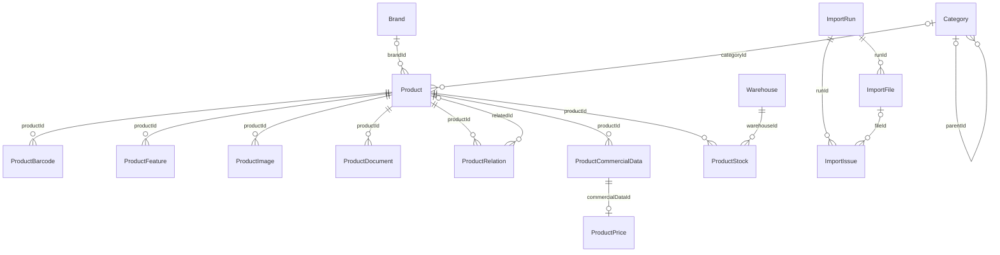

# Технический паспорт: PostgreSQL и Prisma

> Область паспорта: код изучен на ветке разработки `codex/storefront-docker` (коммит `2f20c29`).
> Этот PR — только документация от `origin/main@ccdd8e9`. Каталогов `web/` и
> `deploy/storefront/` в этой базе main нет; упоминания этих путей относятся
> к указанной отдельной ветке разработки, а не к файлам данного PR. Их код сюда не переносится.

Статусы, дата и исходный коммит — в [ARCHITECTURE](ARCHITECTURE.md).
Источники: [schema.prisma](../prisma/schema.prisma),
[миграции](../prisma/migrations/), [PRICAT SQL](../scripts/import/pricat-store.cjs).

## Окружения и запреты

**ЭКСПЛУАТАЦИЯ:** локальная рабочая PostgreSQL 17 и существующая VPS БД
`elektrikamarket` не являются целями экспериментов.
Витрина читает восстановленную копию
`elektrikamarket_test_20261029t010219z_2761a73c` через `storefront_test_ro`.
Это сохраняемая тестовая витрина, а не одноразовая БД интеграционных тестов.
Нельзя запускать на ней очистку, fixtures, импорты или миграции без отдельной задачи.

На завершении развёртывания: 148 872 products, 382 brands, 244 categories,
0 невалидных/неготовых индексов. Полный отпечаток строк и последовательностей
до/после запуска совпал:
`b4a73562feda9b5cd1dfeef897e5df3d5031bf8747a6f6e9bae317ec2671fb9d`.
Это историческая проверка 2026-10-29; при подготовке паспорта к БД не подключались.
Другие числа из старых отчётов не следует выдавать за свежий инвентарь VPS.

## Каталог таблиц

Все таблицы в public; quoted camelCase имена колонок важны для raw SQL.
В прикладной схеме 16 моделей; `_prisma_migrations` — отдельная служебная таблица.

| Prisma → PostgreSQL | Назначение, идентичность и связи |
|---|---|
| Brand → brands | id, уникальные name и slug; Product.brandId nullable. Импорт идентифицирует бренд по trim/NFC name с сохранением регистра |
| Category → categories | Уникальные sourceKey и slug; parentId на Category; lockedFields, isArchived. Дерево RsCatalog, не ETIM |
| Product → products | Уникальные supplierCode и slug; nullable brandId/categoryId/lastProdatFileId; мастер-данные, классификаторы, raw, locks, архив |
| ProductBarcode → product_barcodes | productId + barcode уникальны; barcode строковый, type, sortOrder, origin/isLocked. Один код у разных товаров схема допускает |
| ProductFeature → product_features | productId + identityKey уникальны; featureCode/name/value/uom, sortOrder, origin/isLocked. **Модель есть; импорт ETIM не реализован** |
| ProductImage → product_images | productId + urlKey уникальны; URL, alt, порядок, origin/isLocked. urlKey = SHA256(trim URL), не файл изображения |
| ProductDocument → product_documents | productId + identityKey; type, certificateType, URL, name, порядок, origin/isLocked. Identity включает type/certificateType/URL |
| ProductRelation → product_relations | productId + targetSupplierCode + relationType уникальны; relatedId nullable; analog/related, origin/isLocked. Сохраняет unresolved target |
| Warehouse → warehouses | Уникальный code: stock1/stock2/stock3; имя, порядок, архив |
| ProductCommercialData → product_commercial_data | productId + source уникальны; UOM, ItemsPerUnit/ItemsPerUOM, Multiplicity/raw, flags, rawData, isLocked, importFileId |
| ProductPrice → product_prices | commercialDataId уникален: 0..1 цена на контекст; RetailPrice/CustPrice/Price2/MRC/BSP, валюты, rawData, lock/provenance |
| ProductStock → product_stocks | productId + warehouseId уникальны; quantity nullable, raw, UOM, source, quantityField, даты, lock/provenance |
| ImportRun → import_runs | Тип, версия, статус, сроки, счётчики, message/diagnostics; родитель ImportFile и ImportIssue |
| ImportFile → import_files | runId/source, имя/путь/размер/SHA256, статус, documentDate/raw, metadata/layers; происхождение импортированных значений |
| ImportIssue → import_issues | runId, nullable fileId, severity/code, supplierCode/позиция, message/details. Аудит и входные данные для определения карантина |
| ShopSettings → shop_settings | Единственная строка id=1; protectiveMarkupPercent Decimal(7,3), default 30, updatedAt |

Дополнительные provenance FK: Product.lastProdatFileId и importFileId
в commercialData/price/stock ссылаются на ImportFile. ShopSettings
используется SQL-проекцией через id=1, не через FK.

## Поля, которые нельзя интерпретировать упрощённо

- `supplierCode` — SenderPrdCode одного текущего поставщика, не ItemID/EAN/артикул.
  Supplier и SupplierProduct в схеме отсутствуют.
- Product.uom/itemsPerUnit/itemsPerUom — контекст PRODAT. Цена/продажа использует
  commercialData выбранного источника; эти контексты не взаимозаменяемы.
- Вес/габариты/ItemsPerUnit/Multiplicity — Decimal(20,10);
  quantity — Decimal(20,8); цены — Decimal(14,2). Сохранять точность строками/numeric,
  не промежуточным JavaScript Number в бизнес-арифметике.
- `quantity=NULL` означает неизвестное/отозванное значение, не ноль.
  Положительный quantity ещё не означает возможность продажи.
- `rawData`, `physicalRaw`, metadata, details сохраняют исходный контекст;
  могут содержать коммерчески чувствительные сведения, не для публичной выдачи.
- `countries`, GOST/TY — массивы; ItemsPerUOM — текст, не число.
- Даты склада: sourceUpdatedDate/estimatedArrivalDate — Date;
  documentDate ImportFile — timestamp без зоны, raw сохранён отдельно.
- updatedAt Prisma задаёт при ORM-записи; raw SQL writer сам заполняет его.
  Не рассчитывать на автоматический trigger для всех таблиц.
- ImportIssue — не удаляемая очередь ошибок. Его история участвует в продаже:
  нельзя «почистить логи» и тем самым снять карантин.
- Статус SUCCEEDED у PRICAT не гарантирует errorCount=0: режим quarantine может
  опубликовать допустимые позиции и ошибки отклонённых кодов в одном успешном запуске.

## Enum и ограничения

DataOrigin: PRODAT/MANUAL. CommercialSource: PRICAT1/PRICAT2/MANUAL.
QuantityField: QTY/PARTNER_QTY/MANUAL.
ImportType: PRODAT/PRICAT; ImportSource: PRODAT/PRICAT1/PRICAT2.
ImportStatus: PENDING/RUNNING/SUCCEEDED/FAILED/SKIPPED; severity WARNING/ERROR.

Идентичности закреплены UNIQUE, поиск связей — FK/индексами. Большинство FK имеют
ON DELETE RESTRICT, ON UPDATE CASCADE. Исключение relatedId связи товара —
ON DELETE SET NULL, внешний targetSupplierCode остаётся.
Наличие FK не является разрешением удалять данные.

В SQL последней миграции дополнительно заданы CHECK id=1 для settings и
protectiveMarkupPercent>=0. Они не полностью выражены Prisma-моделью.
Циклы категорий, допустимость UOM, карантин и приоритеты цен проверяются кодом,
а не универсальными CHECK базы.

История: 20260924151204_init → 20261003122244_add_category_source_key →
20261007000000_finalize_import_schema. В исторических SQL есть разрушительные
изменения старой схемы; не выполнять их вручную поверх существующей базы.
Prisma-модель не заменяет проверку фактической истории применённых миграций.

## Будущий снимок доступного ассортимента

[Issue №1](https://github.com/stron111-web/elektrikamarket/issues/1) утверждает подготовку ассортимента после успешного
PRICAT и сохранение последнего корректного снимка при ошибке импорта.
В рассматриваемой схеме нет отдельной модели такого снимка; materialized view
или постоянный кеш для этого также не реализованы. CTE MATERIALIZED текущего
каталога живёт только в рамках запроса. Таблицы/индексы/ACL будущего решения
ещё не выбраны; этот паспорт не разрешает создавать их миграцией.

## Роль витрины

Файл `deploy/storefront/readonly-role.sql` в отдельной ветке
`codex/storefront-docker@2f20c29` (отсутствует в main) создаёт новую роль,
отклоняя другую БД и уже существующее имя. LOGIN, без SUPERUSER/CREATEDB/CREATEROLE/
REPLICATION/BYPASSRLS, NOINHERIT, CONNECTION LIMIT 8.
Настройки: read-only по умолчанию, search_path=public, statement_timeout=30s,
idle_in_transaction_session_timeout=30s.

SELECT выдан ровно на: products, brands, categories, product_images,
product_documents, product_commercial_data, product_prices, product_stocks,
warehouses, shop_settings, import_issues, import_files, import_runs.
Нет доступа к записи, sequence USAGE/UPDATE и чтению истории миграций.
Нет SELECT на barcodes/features/relations: будущий UI этих данных требует
отдельного расширения прав, а не выдачи pg_read_all_data.

SQL также отзывает PUBLIC CREATE на public и PUBLIC TEMPORARY только тестовой БД.
**Граница:** PUBLIC CONNECT других БД глобально не отозван; NOINHERIT не отменяет
PUBLIC privileges. Роль не объявлять полностью изолированной от подключения
к другим БД только на основании этих GRANT. При необходимости строгой сетевой/
database allowlist нужен отдельно согласованный анализ pg_hba и PUBLIC прав.
На этапе развёртывания пользовательских SECURITY DEFINER-функций в public не было.

Ни read-only настройка сессии сама по себе, ни одноимённая роль не заменяют ACL.
Для разработки с записью нужна отдельная одноразовая локальная БД и другая роль.
