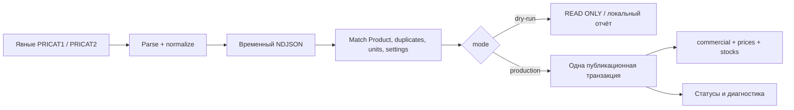

# Технический паспорт: импорт

> Область паспорта: проверенный срез `codex/storefront-docker@2f20c29`.
> Паспорт включён в main через PR №2 (`50d02a2`). Интеграционная ветка
> `codex/integrate-storefront` переносит соответствующие `web/` и `deploy/storefront/`
> без изменения торговых правил. Эти пути доступны в данном checkout.
> Наличие исходников не означает новый деплой или реализацию целевого PRICAT-снимка.

Срез и статусы: [ARCHITECTURE](ARCHITECTURE.md).
Контракты: [PRODAT README](../scripts/import/README.md),
[PRICAT README](../scripts/import/pricat-import.md),
[бизнес-правила](BUSINESS_RULES.md).
Этот документ описывает реализацию и будущий порядок операций, **не разрешает импорт**.

## Что реально запускается

| Инструмент | Поведение и побочные эффекты |
|---|---|
| prodat-dry-run.ts | XML/ZIP-аудит без PostgreSQL; не эквивалент production business dry-run |
| prodat-import.cjs | Production writer; явные --database-url-env и ZIP-части. Не имеет безопасного default dry-run |
| pricat-import.cjs --mode dry-run | Default PRICAT; REPEATABLE READ READ ONLY, временный NDJSON и необязательный локальный report |
| pricat-import.cjs --mode production | Аудит и атомарная публикация коммерческих данных; требует отдельного разрешения |
| prodat-*-audit.cjs / pricat-audit.cjs | Анализ источников; читать конкретный CLI перед запуском, отчёты могут содержать реальные коммерческие данные |
| prodat-repair-slugs.cjs | Отдельный repair; не часть повседневного обновления |
| init-system-data.ts | Запись отсутствующих warehouses/settings; не read-only диагностика |

CLI получают имя переменной URL, а не пароль аргументом. Исходные XML/ZIP,
локальные отчёты и raw diagnostics не включать в Git. Не запускать скрипт только
потому, что в названии есть test/audit: предварительно проверить его side effects.

## PRODAT: мастер-каталог

**КОД:** prodat-v1.3.0. Общие генераторы parseProdatXml/readProdatZip используются
production и parser dry-run. Поддерживаются UTF-8, UTF-16LE/BE, Windows-1251,
BOM/XML declaration; неопределённость кодировки, DTD и некорректный XML отклоняются.
Текущая запись обрабатывается потоково; карта хешей растёт по числу кодов.

Все ZIP-части логического каталога проверяются вместе. Текущий исторический набор:
148 882 исходных записи, 148 872 уникальных SenderPrdCode, 10 идентичных дублей.
Это характеристика набора, не универсальная константа для новых поставок.

1. Получить отдельную session advisory lock PRODAT.
2. Зарегистрировать RUNNING run/files, SHA256/размер/источник.
3. Разобрать все части, включая успешные SHA, для межфайловой проверки дублей.
4. Нормализовать; staging пакетами в PostgreSQL TEMP.
5. Проверить неизменность файлов; опубликовать каталог/слои и успешный аудит
   одной транзакцией. Ошибка отменяет публикацию, FAILED-аудит сохраняется отдельно.
6. При повторе не перепубликовывать завершённые слои; всё равно проверять входной набор.

Идентичность товара — supplierCode. Нормализованный Brand определяется именем;
категория — стабильным RsCatalog sourceKey, иерархия L4 → L3 → L2.
При отсутствии пригодного RsCatalog categoryId=null; фиктивные ETIM-категории не создаются.
Новый slug человекочитаемый, коллизии разрешаются стабильным identity-суффиксом;
существующий slug не меняется при переименовании.

Сравнение дублей консервативное: порядок ключей объекта неважен, порядок массивов
и исходные значения важны, включая ещё не импортируемые поля. Различающийся дубль
PRODAT отменяет набор; политика PRICAT quarantine сюда не переносится.

Слои публикации: базовый каталог, barcodes/ean-v1, images-v1, documents-v1,
relations-v1, отмеченные ImportFile.metadata.layers. Новый слой может дополнить
успешный файл без перезаписи завершённого слоя. Просто изменение VERSION не равно
разрешению перепубликации. Неизменившиеся нормализованные Product не обновляются.

### Вложенные данные

- EAN остаётся строкой, в том числе с ведущими нулями. Неверные GTIN/длина/символы
  сохраняются с диагностикой; неоднозначные пары EAN/Description — ошибка.
- Image/Document — ссылки, без скачивания. Невалидный URL может храниться с WARNING;
  UI допускает только безопасные HTTP(S) URL, а не исправляет поставщика.
- Analog/Related — направленные связи. Неизвестный targetSupplierCode хранится,
  relatedId=null; новых фиктивных Product и обратных связей нет.
- Позднее импортированные цели разрешают незаблокированные PRODAT relations.
- MANUAL/isLocked/lockedFields сохраняются. Исчезнувшие supplier children и Product
  не удаляются текущим writer.
- ProductFeature/ETIM, цены и остатки PRODAT writer не заполняет.

## PRICAT: коммерческий контекст

**КОД:** pricat-v1.0.1; один явный файл на PRICAT1/PRICAT2, допустим запуск одного
источника или обоих. В документе источника ожидается ровно один PRICAT document.
Источники не определяются догадкой по имени файла.

| Данные | Назначение |
|---|---|
| PRICAT1.QTY/UOM | stock1 |
| PRICAT2.QTY/UOM | stock2 |
| PRICAT1.PartnerQTY/PartnerUOM | stock3 |
| Partner LastUpdDate / EstimatedArrivalDate | Даты именно партнёрского остатка |
| SumQTY, PRICAT2.PartnerQTY | Только исходные данные, не дополнительные остатки |
| Коммерческие поля/цены | Отдельный контекст source, не перезапись Product |

PRICAT не создаёт Product. Неизвестный код даёт MISSING_PRODUCT; после добавления
PRODAT можно согласованно повторить PRICAT с reprocess.
ShopSettings id=1 и все три активных склада требуются заранее.

**КОД:** exact decimal нормализация, исходный raw, защитная цена, ограниченные
SQL batches. Default conflictPolicy=quarantine; reject отклоняет обнаруженные
invalid/conflicting records. Разные варианты одного кода карантинируются по источнику;
другой источник и другие товары могут продолжать публикацию.
Подробная семантика UOM/ItemsPerUnit и восстановления — BUSINESS_RULES.

Production получает собственную advisory lock, отличную от PRODAT.
Эти lock **не образуют общую глобальную блокировку двух импортёров**.
Есть табличные блокировки публикации; рекомендуемый эксплуатационный порядок
последовательный, не параллельный.

SHA-cache учитывает source, SHA, успешные file/run, VERSION и protectiveMarkupPercent.
reprocess отключает этот skip, но не разрешает старый snapshot.
DocumentDate проверяется при публикации; более старый не должен заменить новый.
Повтор ранее успешного SHA, уже помеченный как skip, не переписывает новые данные.
Файл, settings и соответствие warehouse code/id перепроверяются перед публикацией.
Режим dry-run не выполняет все проверки внутри production-публикации
(например, отказ от старого snapshot); DRY_RUN не гарантия успешного production.

## Аудит, сбои и повтор

ImportRun — запуск; ImportFile — каждый источник/часть; ImportIssue — диагностика
с кодом, supplierCode, позицией и исходным контекстом. Счётчики не заменяют
проверку конкретных строк и успешности файлов.

У PRODAT каталог, дочерние слои и успешный аудит атомарны. У PRICAT часть
validation issues записывается до публикационной транзакции; ошибка может оставить
FAILED-аудит. Проекция продаж учитывает только SUCCEEDED file **и** run.
При default quarantine успешный PRICAT может иметь ERROR-issues — это не
равнозначно неудавшейся транзакции.

Аварийный RUNNING обрабатывается следующим запуском под соответствующей lock;
нет возобновления с произвольной позиции XML. Потерю связи/ответа COMMIT нужно
диагностировать по зафиксированному статусу, не слепо повторять запись.
Нельзя очищать issues, снимать lock или обнулять склад для «исправления» импорта.

## Утверждённая цель: ассортимент после PRICAT

[Issue №1](https://github.com/stron111-web/elektrikamarket/issues/1), решение 29.10.2026: после успешного обновления PRICAT
один раз формировать готовый к публичному показу ассортимент, затем читать его
в каталоге/пагинации без пересчёта всех товаров на запросе. Неудачный импорт
сохраняет последний корректный снимок, а не заменяет его нулями.
Это утверждённое требование **ещё не реализовано** в importer/Compose; выбор
механизма, момент согласованной публикации и инвалидация требуют отдельного проекта.
Автоматическое ежедневное получение PRICAT также не следует считать готовым.

## Порядок будущего обновления

**РЕКОМЕНДУЕМЫЙ ПЛАН, НЕ АВТОМАТИЗАЦИЯ:**

1. Зафиксировать целевую отдельную БД, владельца операции и резервную копию.
2. Получить полный согласованный набор файлов, metadata/SHA; проверить без записи.
3. PRODAT — сначала каталог и связи, поскольку PRICAT только сопоставляет товары.
4. PRICAT dry-run с явными источниками, анализ conflicts/invalid/UOM/упаковок.
5. После разрешения production PRICAT; при двух источниках одна публикационная
   транзакция. При последовательных разных запусках между ними возможен временный
   срез с разными датами источников — учитывать при эксплуатации.
6. Проверить аудит, цену manual → PRICAT2 → PRICAT1, склады и карантин через общие
   read-функции; сохранить отчёт, а не только exit code.
7. Новый PRODAT или ручное согласование могут потребовать отдельного reprocess.

На сохраняемую VPS тестовую БД этот план автоматически не распространяется.
Ежедневное FTP-скачивание, расписание, уведомления и политика полного/частичного
destructive sync **не реализованы**. Текущая безопасная семантика отсутствия данных —
сохранение, а не удаление/обнуление.
