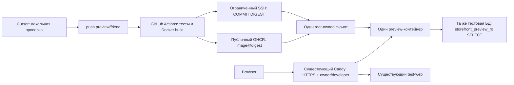

# Preview: упрощённое развёртывание

Статус 30.10.2026: первый preview запущен через GitHub Actions из
`preview/friend@a2b4473`. Проверены HTTPS, owner/developer, каталог, поиск,
карточка, розничная цена, static/health и noindex. Test-web, Caddy и PostgreSQL
сохранили ID/StartedAt; 3000/5432 наружу не опубликованы. Bootstrap повторно не
запускать. Этот документ обновляется отдельным push для проверки автопубликации.
Код основан на `origin/main@6540963`; механизм снимка из другой ветки не включён.

## Состав решения

Один workflow, один серверный скрипт, один дополнительный контейнер.
Установщиков, отдельного SSH-парсера, очередей, webhook, self-hosted runner
и дополнительных сервисов нет. PostgreSQL и Caddy остаются существующими.



Два jobs в одном workflow разделяют сборку и SSH-ключ. Deploy-job не делает
checkout. Сервер принимает только commit и immutable digest из фиксированного
`ghcr.io/stron111-web/elektrikamarket-preview`, проверяет HEAD `preview/friend`
до и после pull и OCI-метки source/ref/revision. Метки проверяют ожидаемую
идентичность, но не являются криптографическим доказательством происхождения.

## Границы безопасности GitHub Actions

**До включения требуется проверка владельцем настроек GitHub.** Изменяемый другом
workflow потенциально способен прочитать любой доступный ему repository/org secret.
Условие `if` в YAML и разделение jobs сами по себе этого не предотвращают.

- Environment `preview`: разрешена только ветка `preview/friend`; единственный
  secret — новый `PREVIEW_DEPLOY_KEY`, variable — проверенный `PREVIEW_KNOWN_HOSTS`.
- Секреты основной витрины и других сервисов должны находиться в отдельных
  защищённых Environments: только main, с подтверждением владельца; либо в отдельных
  репозиториях. Не оставлять их доступными как общие repository/org secrets.
- Не выдавать preview Environment административный SSH-ключ, пароли Basic Auth,
  DB URL, PAT или registry credential других сервисов. Сервер читает публичный GHCR.
- Build-job получает только краткоживущий GITHUB_TOKEN с contents:read/packages:write;
  deploy-job имеет permissions:{} и отдельный ограниченный ключ.
- Проверить также доступ GITHUB_TOKEN к другим GHCR packages этого репозитория:
  запись в пакет основной витрины не должна быть доступна preview workflow.
  Другим package при необходимости убрать наследование Actions-доступа этого
  репозитория и использовать отдельно защищённую публикацию.

Изменённый workflow может похитить **preview-ключ**. Граница полномочий находится
на VPS: forced command и root-owned Compose не дают превратить его в shell,
произвольную Docker-команду, замену Caddy или управление test-web. Изменённый код
самого preview способен прочитать свой DB credential; поэтому роль и пароль БД
отдельные от test. Basic Auth остаётся общей только внутри Caddy.

Владелец настроил Environment preview, ограничение preview/friend и отдельный
CI-ключ; секреты агентом не читались. Первый GitHub→GHCR→VPS цикл подтверждён
успешным Actions run и проверками сервера. Временный required reviewer нужен
только при первом включении; для последующих автоматических push его снимает
владелец. Аудит других repository/org secrets и package permissions остаётся
обязанностью владельца: connector не предоставляет эти административные API.

## Какие объекты появятся или изменятся на VPS

Таблица сохраняет согласованный объём установки. Первичная установка выполнена
владельцем; эти действия не повторять при обычном обновлении preview.

| Объект | Действие |
|---|---|
| `previewdeploy` | Новый key-only Linux-пользователь без docker/sudo-групп |
| Его root-owned `.ssh/authorized_keys` | Отдельный CI-ключ с restrict и forced command |
| `/usr/local/sbin/elektrikamarket-preview` | Единственный проверенный `deployer.py`, root:root 0755 |
| `/etc/sudoers.d/elektrikamarket-preview` | Разрешить только этот исполняемый файл без аргументов |
| `/etc/elektrikamarket-preview/` | root:root 0700, фиксированный compose.yaml и отдельный database_url |
| `/var/lib/elektrikamarket-preview/` | root:root 0700; deploy.lock, images.json, пустые docker/xdg каталоги |
| PostgreSQL | Только создание storefront_preview_ro и SELECT grants в существующей тестовой БД |
| Compose `elektrikamarket-preview` | Единственный сервис preview, без host ports |
| Сети | Присоединить к существующим frontend и database, alias preview-web |
| Caddyfile | Добавить только preview-блок, сохранить существующие настройки и test-блок |
| Caddy | Validate и graceful SIGUSR1; контейнер не пересоздавать |
| Certificate storage | Использовать существующие постоянные тома Caddy |
| Firewall | Новых портов нет: существующие 80/443 и SSH 22 |

Существующие сети: `elektrikamarket-storefront_frontend` и
`elektrikamarket-deploy_default`. PostgreSQL 5432 и Next.js 3000 не публикуются.
Preview: UID/GID 1000, read-only rootfs, cap_drop ALL, no-new-privileges,
512 MiB RAM, 0.75 CPU, 128 pids, ограниченные tmpfs и ротация логов.
Docker socket, серверный rootfs, пароли test и Basic Auth не монтируются.

Сети и PostgreSQL общие: это не полная сетевая изоляция. Дополнительные SELECT
нагружают общий PostgreSQL; лимит CPU preview не ограничивает CPU его SQL.
Роль preview ограничена четырьмя соединениями и statement_timeout 30s.
Новая БД, новые сети и фоновые процессы не нужны.

## Read-only роль

Владелец согласовал отдельную роль и общую Basic Auth; выполнение на VPS пока
не разрешено. `deploy/preview/readonly-role.sql` выполняется один раз владельцем
только после разрешения на установку. Скрипт транзакционно:

- проверяет точное имя `elektrikamarket_test_20261029t010219z_2761a73c`;
- отказывается изменять уже существующую storefront_preview_ro;
- создаёт непривилегированный LOGIN с четырьмя соединениями, read-only default,
  statement_timeout/idle timeout 30s;
- выдаёт CONNECT, USAGE public и SELECT только 13 таблиц действующего reader;
- отклоняет унаследованные PUBLIC-права CREATE/TEMP, не исправляет их автоматически.

Таблицы: products, brands, categories, product_images, product_documents,
product_commercial_data, product_prices, product_stocks, warehouses, shop_settings,
import_issues, import_files, import_runs. Последние нужны текущему SQL карантина.
Миграций, DML, новой БД и изменений других ролей SQL не содержит.
Пароль задаёт владелец интерактивно через psql `\password`, отдельный случайный SCRAM.

Новый `/etc/elektrikamarket-preview/database_url` содержит только URL этой роли.
Родитель root:root 0700; файл UID/GID 1000:1000 mode 0400 для чтения контейнером.
Не передавать URL через CLI, GitHub, build args, Git или журналы.
В `deploy/storefront/start.cjs` добавлен выбор разрешённой роли: по умолчанию
сохранён storefront_test_ro, preview Compose выбирает storefront_preview_ro.
Имя тестовой БД по-прежнему проверяется. Торговая логика не меняется.

## Однократная установка владельцем

После review и отдельного разрешения установить **утверждённую версию** файлов
в фиксированные root-owned пути. Автоматика их не обновляет. Установщика нет;
создание пользователя, каталогов, SQL-роли и правил доступа — разовая операция.

Для ключа в root-owned authorized_keys:

```text
restrict,command="/usr/bin/sudo -n /usr/local/sbin/elektrikamarket-preview" ssh-ed25519 PUBLIC_KEY
```

Home/.ssh и authorized_keys аккаунт не должен иметь возможность переписывать.
Аккаунт без административных групп и с непригодным паролем `*`; проверить effective
sshd policy/AllowUsers/Match и невозможность password login. На предыдущем чтении
один cloud-init include был недоступен: effective policy пока не подтверждена.
Не менять SSH policy автоматически и не переиспользовать ключ shopadmin.

Sudoers, проверить `visudo -cf` перед включением:

```sudoers
Defaults:previewdeploy env_reset, !setenv
previewdeploy ALL=(root) NOPASSWD: /usr/local/sbin/elektrikamarket-preview ""
```

`""` означает разрешение **без аргументов**. Owner-only rollback этим ключом
недоступен. Remote command SSH игнорируется forced command; stdin принимает только
одну строку COMMIT DIGEST. Нет отдельного SSH-парсера. Окружение для дочерних
процессов задано скриптом; caller не выбирает socket, compose, env-файл или сервис.

В существующий Caddyfile вручную добавить `Caddyfile.preview`. Basic Auth импортирует
тот же `/run/secrets/storefront_basic_auth`; пароли и хеши копировать не нужно.
Сохранить backup и исходный prefix/окончания строк. Bind mount сделан отдельным
файлом, поэтому писать **in-place**, сохраняя inode. Затем `caddy validate` и SIGUSR1.
Предварительно подтверждён Caddy 2.11.7 в file-based run-mode с admin off;
[документация сигналов](https://caddyserver.com/docs/command-line#signals).
Успешная отправка сигнала сама по себе не доказывает успешный reload — проверить
HTTPS/401 обоих сайтов и прежние ID/StartedAt test-web, Caddy, PostgreSQL.
Если первая публикация ещё не выполнена, авторизованный preview может отвечать 502.

Настроить GitHub по разделу безопасности. Known_hosts сверить с доверенным
фингерпринтом, не использовать слепой ssh-keyscan/StrictHostKeyChecking=no.
Первую публикацию можно удержать owner review Environment, пока GHCR package
`elektrikamarket-preview` переводится в Public. Публичный репозиторий не делает
package автоматически публичным. После проверки первого запуска снять временное
подтверждение; дальнейшие push preview/friend обновляют сайт автоматически.

## Обновление и откат

Workflow собирает Node.js 24 / Next.js образ существующим Dockerfile. Сервер
проверяет запрос и ветку, скачивает фиксированный digest, проверяет метки,
запускает только preview через Compose --no-deps и ждёт container health.
Затем проверяет внутренний /catalog (200) и публичные HTTPS /catalog, /api/health,
static (401 без авторизации, с проверкой сертификата). Пароли Basic Auth для
автопроверки не сохраняются. Оба логина/карточки/поиск проверяются владельцем при
активации и локальным интеграционным тестом.

GitHub concurrency не отменяет выполняющийся deploy; flock защищает серверную
операцию от параллельного запуска. `images.json` хранит только current/previous
commit+digest, записывается атомарно. Дополнительного журнала состояний нет.

При обнаруженной ошибке запуска/проверки восстанавливается предыдущий проверенный
preview; при первой неудаче останавливается только preview. При ошибке самого
отката скрипт завершает работу и требует проверки владельцем, без удаления данных
и автоматического ремонта. Owner-команда:

```sh
sudo /usr/local/sbin/elektrikamarket-preview rollback
```

Откат использует локальный образ, не registry и не основную витрину. Старые образы
не удалять до проверки релиза: автоматических prune нет. Замена одного контейнера
даёт краткий перерыв preview, zero-downtime не обещается.

При обрыве питания/SIGKILL между переключением контейнера и записью references
images.json может отставать от фактического контейнера. Сложного recovery-журнала
нет: владелец проверяет текущий digest и повторяет утверждённый deploy либо rollback.
Не удалять references и не чистить Docker cache как способ ремонта.

## Проверки и ограничения

Локальные unit tests покрывают ограниченный stdin, branch/digest/OCI identity,
фиксированный Compose/очищенное окружение, root-owned файлы, lock, idempotency,
ошибки, первоначальный отказ и откат. Отдельные startup tests проверяют default
роль test и выделенную preview, запрет admin/другой БД/подмены роли.

Полная репетиция использует исключительно одноразовые локальные Docker-ресурсы:
копию архива после SHA-256, PostgreSQL, две сети, test+preview и один Caddy с локальным
CA. Проверяются read-only ACL, HTTPS/auth обоих пользователей, noindex, карточки,
поиск, static, обновление preview и rollback при неизменных test/Caddy. Fixture
не публикует host ports; созданные контейнеры, сети, том и временные секреты удаляются.

```sh
docker build -f web/Dockerfile -t elektrikamarket-preview:local-check .
node deploy/preview/check-local.cjs /absolute/private/database.dump elektrikamarket-preview:local-check
```

Результаты актуального прогона сообщаются в итоговом отчёте; прошлый PASS не заменяет
новую проверку. Public ACME, реальный forced SSH/sudo и первый GitHub→GHCR→VPS
цикл проверены 30.10.2026. Данные локального прогона ниже сохранены отдельно.

Справочно: [GitHub Environments](https://docs.github.com/en/actions/how-tos/deploy/configure-and-manage-deployments/manage-environments),
[безопасность Actions](https://docs.github.com/en/actions/reference/security/secure-use).
Другу: [PREVIEW_FRIEND.md](PREVIEW_FRIEND.md).

### Результаты локального прогона 30.10.2026

- 19 Python unit tests прошли в Linux-контейнере с UID 1000, без root и сети.
- 6 Node startup tests прошли; actionlint 1.7.7 не обнаружил ошибок workflow.
- Production Docker image собран успешно. Next.js/TypeScript слой использован
  из Docker cache; исходники UI и торговой логики не менялись.
- Полная репетиция с новым storefront_preview_ro прошла на локально восстановленной
  копии архива с проверенным SHA-256: 148 872 products, прав записи в таблицы нет,
  UPDATE запрещён даже при отключении default read-only.
- Для обоих доменов локального Caddy прошли owner/developer, 401 без пароля и с
  неверным паролем, noindex, поиск 82066, карточки/розничная цена, static и health.
- Preview обновлён на другой image ID и возвращён обратно; HTTP-проверки повторены.
  ID/StartedAt test-web и Caddy остались прежними. Host ports не опубликованы.
- Одноразовые контейнеры, сети, том и файлы fixture удалены.

Это локальный результат, не подтверждение установки или публичного HTTPS на VPS.

### Первый запуск на VPS 30.10.2026

- [GitHub Actions run 41112894097](https://github.com/stron111-web/elektrikamarket/actions/runs/41112894097): success, commit a2b4473.
- Образ GHCR доступен анонимно по immutable digest; preview healthy.
- Под owner и developer каталог возвращает 200 на test и preview, без вывода паролей.
- Каталог, поиск 82066, карточка/розничная цена, static и health проверены.
- Без авторизации корень, каталог, API, карточки и static возвращают 401; HTTPS и noindex действуют.
- ID/StartedAt test-web, Caddy и PostgreSQL не изменились.
- Следующий push меняет только документацию: он проверяет реальный повторный build/deploy без изменения UI и торговых правил.
