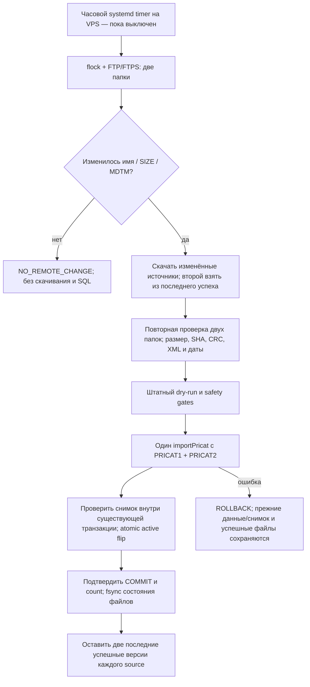

# Автоматическое обновление PRICAT на VPS

## Исправления 02.11.2026 — pricat-v1.1.1 (на базе 5825e4b)

PRODAT в проверенной копии последний раз успешно обновлялся 09.10.2026. Неизвестных
кодов в паре 30.10 было 30904, в паре 02.11 — 32444: 29943 общих, 2501 добавились,
961 исчез. Из добавившихся 872 встречались в более ранних PRICAT; 1629 отсутствуют
в доступной истории, что само по себе не доказывает дату создания товара у РС.
Число известных товаров в паре выросло 120038 → 124462, структура XML не изменилась,
дубли сохранились 40/29 строк. Для расширения каталога требуется отдельное обновление
PRODAT; PRICAT никогда не создаёт Product и дочерние мастер-данные.

`maxMissingFraction` не повышается: это диагностический ориентир доли неизвестных,
а не запрет обновления известных товаров при устаревшем PRODAT. `dry-summary.json`
сохраняется до проверки gates. CHECKED/SUCCEEDED и безопасный status содержат
matching: число неизвестных/известных, долю, превышение ориентира и данные по источникам.
Маскировку усечённого/неправильно разобранного файла неизвестными кодами блокирует
`KNOWN_PRODUCT_COVERAGE_DROP`: каждый источник обязан сохранить известное покрытие
в пределах явно заданного `maxMatchedDropFraction`. Предел калибруется по падению
matched на уже проверенных реальных парах, без произвольной надбавки. Отдельно
сохраняются CRC/SHA/XML/даты, числа строк и уникальных кодов, доля ошибок и
транзакционные проверки ассортимента, цен и складов перед переключением снимка.

Нормализатор принимает только хвосты, укладывающиеся одновременно в 8×EPSILON
относительно исходного значения и 10^-12 абсолютно, через точную BigInt-арифметику.
Например, 19.250000000000018 → 19.25; настоящие 8 знаков дробной части не меняются,
допуск не означает округление до двух знаков. quantityRaw сохраняется; UOM и размер
упаковки не участвуют в этом преобразовании. Значения вне допуска карантинятся.
Новый VERSION обеспечивает повторную проверку файла, отклонённого прежней версией.

Следующие результаты v1.1.0 — история, не новый прогон и не подтверждение cron.

## Актуализация 02.11.2026 — pricat-v1.1.0

Следующие разделы сохраняют историю разработки; новые правила и фактические
результаты этой актуализации имеют приоритет. Расписание этой версии пока **не
установлено и не включено**; целевая рабочая БД требует явного выбора владельцем,
поскольку наполненный каталог сейчас общий для test и preview.

- Полный валидный источник заменяет остатки своих складов; отсутствие кода/количества
  даёт 0. Дубликаты/ошибочные записи сохраняют карантин. MANUAL/locked и торговые
  приоритеты сохраняются, неподтверждённый protected stock исключается своим складом.
- Проверено на свежем backup общей каталожной БД от 02.11.2026, восстановленном
  в **отдельный локальный Docker PostgreSQL 17**. Backup SHA-256:
  `f1e4ca06051e66032fb3ea62c936312ad3d4e62b3fc9f5720642871b9edca07d`, 111456334 bytes.
- Контрольная пара — реальные PRICAT от 30.10.2026. Обнулены ровно **27919** прежних
  положительных supplier-остатков: stock1 **2457**, stock2 **3058**, stock3 **22404**.
  Среди всех 27919 проверенных ни одного положительного значения не осталось.
- 31 дробная погрешность нормализована; 34 stock3 UOM-конфликта не попали в продажу,
  единицы не преобразовывались. Корректные другие склады сохраняют доступность.
- На копии новый ассортимент **108728** товаров против прежних 125082; полный
  EXCEPT ALL между новым снимком и каноническим расчётом дал **0/0** расхождений.
  Полный dry-run + импорт + контроль заняли около **174 секунд локально**.
- Одна изменённая версия использует последнюю успешную пару без ожидания синхронной
  даты второго файла. Для повторно используемого старого файла age/skew не блокируют
  новую версию: SHA дополнительно обязан совпасть с принятым active snapshot.
- Доказанный FAILED audit после транзакционного отката разрешает следующий запуск.
  Неопределённый COMMIT/потеря подтверждения оставляет needs-review marker.

### Запуск от shopadmin без sudo

На VPS проверены `/usr/bin/crontab`, включённый и работающий cron. Можно использовать
существующий cron и одноразовый Docker-контейнер, не устанавливая новые сервисы.
Подготовленные run-update.sh/run-scheduled.sh поддерживают private owner-каталог
`/home/shopadmin/elektrikamarket-pricat`: runtime 0700, конфигурация/FTP/DB secrets
0600, state 0700, runtime.env содержит только pinned image ID и Docker network.
Существующие FTP credentials копируются защищённо; значения не входят в argv/Git.

Только после успешного check, backup и разрешённого первого publish можно добавить
одну строку в crontab shopadmin, сохраняя все существующие строки:

```cron
*/30 * * * * /home/shopadmin/elektrikamarket-pricat/run-scheduled.sh publish >> /home/shopadmin/elektrikamarket-pricat/scheduler.log 2>&1
```

Cron уже запускается после перезагрузки. Host flock + фиксированное имя Docker
исключают параллельный штатный updater. После удержания host flock и проверки
отсутствия контейнера допустимо удалить только пустые stale lock directories;
data/needs-review markers не удаляются. Изображение, UID1001, read-only filesystem,
cap-drop/no-new-privileges, лимиты CPU/RAM/pids, отсутствие published ports сохранены.
Системный timer как альтернативный способ тоже подготовлен на 30 минут,
Persistent=true; оба способа одновременно не активировать.

Одна команда статуса после установки:

```bash
/home/shopadmin/elektrikamarket-pricat/run-scheduled.sh status
```

Она читает только safe filesystem state, без DB URL/паролей/сетевого соединения.
Показывает даты документов PRICAT1/2 отдельно от acceptedAt, последний check/publish,
snapshotId, обновления/обнуления и диагностики карантина последней публикации.
Диагностики карантина — число событий данного импорта, не выдуманное число уникальных
остатков; при сомнении сверять точные складские записи на read-only запросе.

Операционные policy в config.example.json по-прежнему не заполнены произвольными
числами. В локальных release-артефактах CALIBRATED_POLICY.json пределы изменений
вычислены по фактическому сравнению проверенной пары с её baseline, без произвольного
запаса. Калибровка не выполняется автоматически по новому/отказавшему кандидату:
выход за эти пределы останавливает публикацию и требует разбора. Технические пределы
сроков, размеров и свободного места указаны отдельно от наблюдавшихся изменений.
Перед рабочим запуском сверить, что baseline не изменился со времени репетиции.
Статус установки/активации нельзя выводить из наличия файлов или unit definitions.

Статус: **реализовано и проверено локально** в `codex/pricat-auto-update` от `7ca5122`.
На VPS обвязка, образ и systemd units не устанавливались; расписание не включено,
реальный импорт в сохраняемую БД не запускался. Windows используется только для
разработки и изолированных тестов. Все будущие рабочие проверки, скачивания,
хранение и импорт выполняются непосредственно в одноразовом контейнере на VPS.
Никаких новых таблиц, миграций, очередей или постоянных сервисов не добавлено.

## Подтверждённые источники и разрешённый протокол

Владелец указал `service.russvet.ru:21021` и каталоги `/pricat/`, `/pricat/TVER/`.
01.11.2026 соответствие повторно проверено read-only запросом на VPS:

| Source | Каталог | Код/формат | Подтверждение существующим импортом |
|---|---|---|---|
| PRICAT1 | `/pricat/` | 2610, ZIP | ImportFile 13 SUCCEEDED, `PRICAT_891661_2610_20260924035017.zip`, DocumentNumber `891661_2610_20260924035017` |
| PRICAT2 | `/pricat/TVER/` | 2630, XML | ImportFile 14 SUCCEEDED, `PRICAT_891661_2630_20260928034015.xml`, DocumentNumber `891661_2630_20260928034015` |

Это подтверждает спецификацию §2.2: PRICAT1.QTY → stock1,
PRICAT2.QTY → stock2, PRICAT1.PartnerQTY → stock3. Никакого вывода назначения
склада из произвольного имени файла штатным импортёром не добавлено.

**Уточнение владельца 01.11.2026:** обычный FTP для этого endpoint явно разрешён,
риск принят. Прежний probe (220; AUTH TLS/SSL → 500, без USER/PASS) остаётся фактом,
но больше не блокирует работу. В `ftp` нужны `secure:false` и
`allowPlaintextForRussvet:true`; исключение действует только для точных
`service.russvet.ru:21021`. У других серверов/портов plain FTP запрещён, отсутствие
secure означает FTPS. Автоматического downgrade после ошибки TLS нет.
[Передача реквизитов и разовый анализ](PRICAT_FTP_ACCESS.md) — следующий этап;
рабочий импорт и расписание пока не разрешены.
## Один процесс и существующий импортёр



- `scripts/pricat-update/ftps.cjs`: basic-ftp 6.2.4, passive FTPS, минимум TLS1.2,
  проверка CA/hostname и TLS до USER/PASS по умолчанию. Только для явно разрешённого
  endpoint возможен обычный FTP. Для FTPS дополнительно требуются положительные
  ответы PBSZ 0 и PROT P: библиотека сама игнорирует их отрицательные ответы.
  В FTPS данные тоже шифруются; другой transfer host не разрешается. FTP verbose выключен.
  Ключи/пароли читаются процессом из private JSON, не argv и не журналы.
- `sync.cjs`: проверяет обе папки, собирает полную пару и управляет двумя
  успешными версиями. Имя строго `PRICAT_<customerCode>_<2610|2630>_<14 digits>.<zip|xml>`;
  customerCode=891661 подтверждён прежними файлами, но требует сверки с новым доступом.
  Чужие коды/клиенты/временные суффиксы игнорируются, неоднозначный newest запрещён.
- `update.cjs`: существующая локально подготовленная обвязка manifest-пары;
  проверяет доставку и вызывает прежний `importPricat`. Его CLI самостоятельно
  файлы не скачивает; API используется ради transactional safety callbacks.
  Прямой manual HTTPS/local manifest режим сохранён, runtime ENTRYPOINT теперь sync.
- `pricat-import.cjs`, normalizer/store и snapshot builder **не менялись**.
  MANUAL/locked, manual → PRICAT2 → PRICAT1, защитная наценка, UOM/ItemsPerUnit,
  NMP, кратность, три склада и карантин остаются в проверенных общих функциях.

## Как выбирается и проверяется пара

Обе папки должны быть доступны на каждом запуске. Из matching файлов выбирается
максимальный timestamp имени; обязательно поддерживаются SIZE и MDTM. Минимальный
возраст изменения файла задаётся settleSeconds (не присваивается без согласования).
При первой подготовке нужны оба источника; в последующем неизменный source
берётся только из локального кеша **последнего подтверждённого успеха**. Файл,
прошедший лишь check или неудавшийся импорт, не становится fallback.

При изменении одного источника прежний второй по-прежнему проходит SHA/XML/date
проверки; прежние ограничения возраста и разрыва дат не отключаются. Если он уже
слишком стар по утверждённой policy, публикация останавливается, а не «исправляет»
настройку автоматически. Изменившиеся оба источника передаются одним importPricat.

Для скачанного файла проверяются размер до/после RETR, предел объёма и полный
таймаут передачи; SHA считается потоково. Затем повторяется discovery обеих папок,
чтобы обнаружить сменившуюся пару во время скачивания. ZIP: ровно один XML,
потоковый CRC32 и лимит раскрытия. Проверяет прежний readPricat: полный XML,
DocType, даты, отсутствие DTD, кодировки и минимальное число строк. DocumentNumber
и DocumentDate должны точно совпасть с подтверждённым шаблоном имени (без PRICAT_).
Новый SHA при неизменной дате документа и движение даты назад запрещены.

Поставщик пока не предоставил внешние контрольные суммы/маркер окончания загрузки.
Наш SHA подтверждает идентичность локальной копии, а не независимую подпись РС.
Нужны подтверждённый TLS, стабильные SIZE/MDTM, settle window и содержательные
проверки. Точное одновременное поколение двух независимых складов без supplier
manifest доказать нельзя; допустимый skew задаётся явно. Перезапись файла с теми же
именем, размером и MDTM между проверками не выявляется без повторного скачивания:
перед запуском подтвердить у РС неизменность timestamp-версий или наличие HASH/SHA.

## Пороговые проверки и транзакция

Все policy в template намеренно `null`, это блокировка случайного запуска.
До публикации необходимо утвердить:

- maxAgeHours, maxPairSkewHours, maxFutureMinutes, settleSeconds; timestamp parser
  уже использует UTC — timezone РС требуется подтвердить, не переопределять молча;
- minSourceRecords, maxFileBytes/maxXmlBytes, minFreeBytes и downloadTimeoutMs;
- maxSourceDropFraction для строк и уникальных кодов относительно прошлого импорта;
- maxIssueFraction и maxMatchedDropFraction штатного dry-run; maxMissingFraction — диагностический ориентир;
- maxRemovedFraction, maxChangedPriceFraction, maxPriceChangeFactor;
- maxStockCellLossFraction и maxQuantityChangeFactor по каждому складу отдельно.

Подмена усечённого файла дублями не обходит проверку уникальных товаров. Проверки
изменения ассортимента/цен/складов исполняются через beforeSnapshotActivate в
**той же** штатной source/snapshot транзакции, соединение берётся из beforePublish.
При отказе source-данные и новый active откатываются; FAILED-аудит может остаться.
Новый набор торговых правил не создаётся. Требуется непустой корректный baseline;
bootstrap, скрытый reprocess, самостоятельная смена markup не выполняются.

## Блокировки, повторы, два успешных файла

Host flock, `ftp/sync.lock`, прежний run.lock, advisory locks обвязки 1707312403
и импортёра 1707312402 предотвращают параллельные публикации. PRODAT/ручные
административные изменения выполнять в отдельном согласованном окне.

- Неизменные remote metadata — без загрузки, импорта или нового audit.
- Изменённая metadata при тех же байтах — UNCHANGED без нового snapshot/версии.
- Первый sync может принять пару из FTP/FTPS, уже точно совпадающую с текущим active:
  проверенный UNCHANGED считается успешной инициализацией дискового кеша.
- `ftp/versions/PRICAT1|PRICAT2/<sha>.<format>` содержит максимум две последние
  успешные **различные по SHA** версии каждого источника. Неизменный source не
  вытесняет собственную предыдущую версию при обновлении второго.
- Новый state.json пишется с fsync файла и каталога только после подтверждённого
  результата и read-only post-commit проверки. Лишь затем удаляется третья версия.
  Дубли исходников из завершённых SUCCEEDED/UNCHANGED run-каталогов удаляются;
  result/verified/issues журналы сохраняются. CHECKED/failed диагностика не является
  историей успешных файлов и может занимать дополнительное место; её очистка ручная.
- До publish записываются needs-review markers файловой обвязки и прежнего updater.
  Ошибка/разрыв после возможного COMMIT не трактуется как откат. Следующий запуск
  остановлен до сверки ImportRun/ImportFile/active snapshot и файлов. Автоматических
  исправлений, restore поверх DB и снятия stale locks нет. При ошибке до публикации
  успешный кеш не меняется; незавершённая кандидатная пара может сохраняться для разбора.

Родительские каталоги 0700, файлы 0600. `ftp/events.ndjson` и прежние run/result
содержат status/ids/count/безопасные коды, stdout/journald — то же. Никаких
секретов, URL с credentials, паролей, raw закупок или содержимого файлов в логах.
Нет автоматического crash recovery между PostgreSQL и файловой системой: marker
сознательно требует оператора вместо рискованной повторной публикации.

## Подготовленные VPS-файлы — пока не установлены

`docker build -f deploy/pricat/Dockerfile -t <TAG> .` создаёт одноразовый Node24
контейнер с одним FTP/FTPS-клиентом; это не новый постоянно работающий сервис.
Dockerfile-specific ignore включает только package/lock и нужные модули;
.env/.git/keys/исходные архивы/fixtures/tests в image не входят.

После отдельного разрешения:

1. Выбрать целевую DB, сделать свежий проверенный backup, репетировать обновление
   на её изолированной восстановленной копии. Текущая сохраняемая test/preview
   копия не становится автоматически разрешённой для регулярного импорта.
2. Установить root-owned run-update.sh в /usr/local/libexec/elektrikamarket-pricat-update,
   service/timer в /etc/systemd/system/, **без enable/start**.
3. Root-only /etc/elektrikamarket-pricat и /var/lib/elektrikamarket-pricat. Их дочерние
   runtime/state UID1001:GID1001 0700 доступны только одноразовому контейнеру:
   /run/config read-only, /state read-write. config/database_url/ftp-credentials.json
   readable UID1001 0400/0600, state/tmp writable UID1001. Родителей других сервисов
   и существующие учётные записи не менять.
4. В runtime.env: PRICAT_IMAGE=sha256:<verified image ID>,
   PRICAT_NETWORK=<existing DB Docker network>. Database URL — private файл с
   правами штатного importer, не storefront_* роль; FTP private JSON имеет
   только username/password. Не передавать доступы в GitHub, argv, build args.
5. CPU/RAM/pids лимиты, --read-only/cap-drop/no-new-privileges, UID1001, tmpfs,
   без published ports, Docker socket, новых БД и изменений web/PG/Caddy.

Первый разрешённый запуск: wrapper check (без записи в DB, кеш успеха не заменяет).
Далее ручной publish с backup/сверкой. Только затем отдельное разрешение включить
hourly timer: `*-*-* *:00:00 UTC`, jitter до 2 минут, Persistent=false, Restart=no.
Сборка/скачивание и весь импорт выполняются на VPS; ПК владельца не нужен.

## Проверки и границы доказанного

Исторический прогон 31.10.2026 (не выдавать за новый): 110 passed/0 failed/1 skipped,
восстановленная копия 148872 Product, публикация 125082 offers, полный EXCEPT ALL
по ценам/закупке/складам/упаковкам missing=0/extra=0. Обвязка ~135 секунд локально.

Новая FTPS-реализация проверяется отдельными тестами sync.test.cjs и update.test.cjs
в новых одноразовых PostgreSQL 17. FTPS fixture имеет локальный CA, TLS control/data;
VPS-каталог при этой работе прочитан только для подтверждения mapping. Реальное
скачивание с РС, его listing/MDTM/формат нового поколения и production throughput
пока не проверены: ожидается безопасная передача FTP-реквизитов владельцем.
Сетевой lost-COMMIT/жёсткое отключение питания не моделировались; для них marker STOP.

Первый рабочий запуск требует безопасной установки разрешённого FTP-доступа,
проверки реального listing/метаданных, утверждения policy и целевой DB, backup и
репетиции свежей пары. Windows-источники или ручной manifest для регулярной работы
больше не требуются. Реальные результаты текущего прогона — в [VALIDATION.md](../deploy/pricat/VALIDATION.md).
