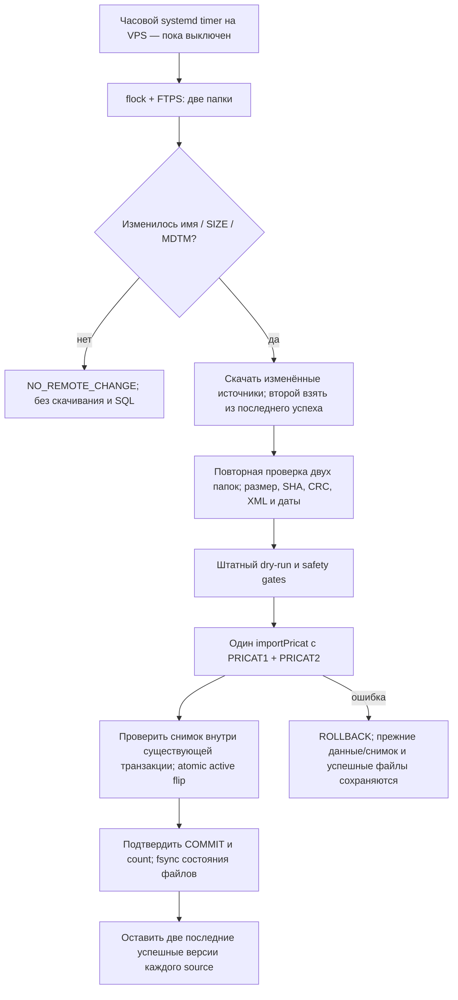

# Автоматическое обновление PRICAT на VPS

Статус: **реализовано и проверено локально** в `codex/pricat-auto-update` от `7ca5122`.
На VPS обвязка, образ и systemd units не устанавливались; расписание не включено,
реальный импорт в сохраняемую БД не запускался. Windows используется только для
разработки и изолированных тестов. Все будущие рабочие проверки, скачивания,
хранение и импорт выполняются непосредственно в одноразовом контейнере на VPS.
Никаких новых таблиц, миграций, очередей или постоянных сервисов не добавлено.

## Подтверждённые источники и блокирующее ограничение

Владелец указал `service.russvet.ru:21021` и каталоги `/pricat/`, `/pricat/TVER/`.
01.11.2026 соответствие повторно проверено read-only запросом на VPS:

| Source | Каталог | Код/формат | Подтверждение существующим импортом |
|---|---|---|---|
| PRICAT1 | `/pricat/` | 2610, ZIP | ImportFile 13 SUCCEEDED, `PRICAT_891661_2610_20260924035017.zip`, DocumentNumber `891661_2610_20260924035017` |
| PRICAT2 | `/pricat/TVER/` | 2630, XML | ImportFile 14 SUCCEEDED, `PRICAT_891661_2630_20260928034015.xml`, DocumentNumber `891661_2630_20260928034015` |

Это подтверждает спецификацию §2.2: PRICAT1.QTY → stock1,
PRICAT2.QTY → stock2, PRICAT1.PartnerQTY → stock3. Никакого вывода назначения
склада из произвольного имени файла штатным импортёром не добавлено.

**БЛОКЕР:** проверка с VPS без логина и пароля получила greeting 220,
`AUTH TLS → 500`, `AUTH SSL → 500`. На указанном endpoint явный FTPS не работает.
Учётные данные не запрашивались/не передавались; анонимный вход не выполнялся.
Наличие другого TLS/SFTP/HTTPS endpoint не известно и не предполагается.
Имплементация требует FTPS с валидным сертификатом; plain FTP, TLS bypass и
автоматическое понижение защиты отсутствуют. До защищённого канала первый
рабочий запуск невозможен. Запросить у РС включение FTPS либо документированный
защищённый endpoint. Другой протокол потребует отдельного проверенного адаптера.

## Один процесс и существующий импортёр

- `scripts/pricat-update/ftps.cjs`: basic-ftp 6.2.4, passive FTPS, минимум TLS1.2,
  проверка CA/hostname, TLS до USER/PASS. Дополнительно требуются положительные
  ответы PBSZ 0 и PROT P: библиотека сама игнорирует их отрицательные ответы.
  Данные тоже шифруются; другой transfer host не разрешается. FTP verbose выключен.
  Ключи/пароли читаются процессом из private JSON, не argv и не журналы.
- `sync.cjs`: проверяет обе папки, собирает полную пару и управляет двумя
  успешными версиями. Имя строго `PRICAT_<customerCode>_<2610|2630>_<14 digits>.<zip|xml>`;
  customerCode=891661 подтверждён прежними файлами, но требует сверки с новым доступом.
  Чужие коды/клиенты/временные суффиксы игнорируются, неоднозначный newest запрещён.
- `update.cjs`: существующая локально подготовленная обвязка manifest-пары;
  проверяет доставку и вызывает прежний `importPricat`. Его CLI самостоятельно
  файлы не скачивает; API используется ради transactional safety callbacks.
  Прямой manual HTTPS/local manifest режим сохранён, runtime ENTRYPOINT теперь sync.
- `pricat-import.cjs`, normalizer/store и snapshot builder **не менялись**.
  MANUAL/locked, manual → PRICAT2 → PRICAT1, защитная наценка, UOM/ItemsPerUnit,
  NMP, кратность, три склада и карантин остаются в проверенных общих функциях.

## Как выбирается и проверяется пара

Обе папки должны быть доступны на каждом запуске. Из matching файлов выбирается
максимальный timestamp имени; обязательно поддерживаются SIZE и MDTM. Минимальный
возраст изменения файла задаётся settleSeconds (не присваивается без согласования).
При первой подготовке нужны оба источника; в последующем неизменный source
берётся только из локального кеша **последнего подтверждённого успеха**. Файл,
прошедший лишь check или неудавшийся импорт, не становится fallback.

При изменении одного источника прежний второй по-прежнему проходит SHA/XML/date
проверки; прежние ограничения возраста и разрыва дат не отключаются. Если он уже
слишком стар по утверждённой policy, публикация останавливается, а не «исправляет»
настройку автоматически. Изменившиеся оба источника передаются одним importPricat.

Для скачанного файла проверяются размер до/после RETR, предел объёма и полный
таймаут передачи; SHA считается потоково. Затем повторяется discovery обеих папок,
чтобы обнаружить сменившуюся пару во время скачивания. ZIP: ровно один XML,
потоковый CRC32 и лимит раскрытия. Проверяет прежний readPricat: полный XML,
DocType, даты, отсутствие DTD, кодировки и минимальное число строк. DocumentNumber
и DocumentDate должны точно совпасть с подтверждённым шаблоном имени (без PRICAT_).
Новый SHA при неизменной дате документа и движение даты назад запрещены.

Поставщик пока не предоставил внешние контрольные суммы/маркер окончания загрузки.
Наш SHA подтверждает идентичность локальной копии, а не независимую подпись РС.
Нужны подтверждённый TLS, стабильные SIZE/MDTM, settle window и содержательные
проверки. Точное одновременное поколение двух независимых складов без supplier
manifest доказать нельзя; допустимый skew задаётся явно. Перезапись файла с теми же
именем, размером и MDTM между проверками не выявляется без повторного скачивания:
перед запуском подтвердить у РС неизменность timestamp-версий или наличие HASH/SHA.

## Пороговые проверки и транзакция

Все policy в template намеренно `null`, это блокировка случайного запуска.
До публикации необходимо утвердить:

- maxAgeHours, maxPairSkewHours, maxFutureMinutes, settleSeconds; timestamp parser
  уже использует UTC — timezone РС требуется подтвердить, не переопределять молча;
- minSourceRecords, maxFileBytes/maxXmlBytes, minFreeBytes и downloadTimeoutMs;
- maxSourceDropFraction для строк и уникальных кодов относительно прошлого импорта;
- maxIssueFraction, maxMissingFraction штатного dry-run;
- maxRemovedFraction, maxChangedPriceFraction, maxPriceChangeFactor;
- maxStockCellLossFraction и maxQuantityChangeFactor по каждому складу отдельно.

Подмена усечённого файла дублями не обходит проверку уникальных товаров. Проверки
изменения ассортимента/цен/складов исполняются через beforeSnapshotActivate в
**той же** штатной source/snapshot транзакции, соединение берётся из beforePublish.
При отказе source-данные и новый active откатываются; FAILED-аудит может остаться.
Новый набор торговых правил не создаётся. Требуется непустой корректный baseline;
bootstrap, скрытый reprocess, самостоятельная смена markup не выполняются.

## Блокировки, повторы, два успешных файла

Host flock, `ftp/sync.lock`, прежний run.lock, advisory locks обвязки 1707312403
и импортёра 1707312402 предотвращают параллельные публикации. PRODAT/ручные
административные изменения выполнять в отдельном согласованном окне.

- Неизменные remote metadata — без загрузки, импорта или нового audit.
- Изменённая metadata при тех же байтах — UNCHANGED без нового snapshot/версии.
- Первый sync может принять пару из FTPS, уже точно совпадающую с текущим active:
  проверенный UNCHANGED считается успешной инициализацией дискового кеша.
- `ftp/versions/PRICAT1|PRICAT2/<sha>.<format>` содержит максимум две последние
  успешные **различные по SHA** версии каждого источника. Неизменный source не
  вытесняет собственную предыдущую версию при обновлении второго.
- Новый state.json пишется с fsync файла и каталога только после подтверждённого
  результата и read-only post-commit проверки. Лишь затем удаляется третья версия.
  Дубли исходников из завершённых SUCCEEDED/UNCHANGED run-каталогов удаляются;
  result/verified/issues журналы сохраняются. CHECKED/failed диагностика не является
  историей успешных файлов и может занимать дополнительное место; её очистка ручная.
- До publish записываются needs-review markers файловой обвязки и прежнего updater.
  Ошибка/разрыв после возможного COMMIT не трактуется как откат. Следующий запуск
  остановлен до сверки ImportRun/ImportFile/active snapshot и файлов. Автоматических
  исправлений, restore поверх DB и снятия stale locks нет. При ошибке до публикации
  успешный кеш не меняется; незавершённая кандидатная пара может сохраняться для разбора.

Родительские каталоги 0700, файлы 0600. `ftp/events.ndjson` и прежние run/result
содержат status/ids/count/безопасные коды, stdout/journald — то же. Никаких
секретов, URL с credentials, паролей, raw закупок или содержимого файлов в логах.
Нет автоматического crash recovery между PostgreSQL и файловой системой: marker
сознательно требует оператора вместо рискованной повторной публикации.

## Подготовленные VPS-файлы — пока не установлены

`docker build -f deploy/pricat/Dockerfile -t <TAG> .` создаёт одноразовый Node24
контейнер с одним FTPS-клиентом; это не новый постоянно работающий сервис.
Dockerfile-specific ignore включает только package/lock и нужные модули;
.env/.git/keys/исходные архивы/fixtures/tests в image не входят.

После отдельного разрешения:

1. Выбрать целевую DB, сделать свежий проверенный backup, репетировать обновление
   на её изолированной восстановленной копии. Текущая сохраняемая test/preview
   копия не становится автоматически разрешённой для регулярного импорта.
2. Установить root-owned run-update.sh в /usr/local/libexec/elektrikamarket-pricat-update,
   service/timer в /etc/systemd/system/, **без enable/start**.
3. Root-only /etc/elektrikamarket-pricat и /var/lib/elektrikamarket-pricat. Их дочерние
   runtime/state UID1001:GID1001 0700 доступны только одноразовому контейнеру:
   /run/config read-only, /state read-write. config/database_url/ftp-credentials.json
   readable UID1001 0400/0600, state/tmp writable UID1001. Родителей других сервисов
   и существующие учётные записи не менять.
4. В runtime.env: PRICAT_IMAGE=sha256:<verified image ID>,
   PRICAT_NETWORK=<existing DB Docker network>. Database URL — private файл с
   правами штатного importer, не storefront_* роль; FTP private JSON имеет
   только username/password. Не передавать доступы в GitHub, argv, build args.
5. CPU/RAM/pids лимиты, --read-only/cap-drop/no-new-privileges, UID1001, tmpfs,
   без published ports, Docker socket, новых БД и изменений web/PG/Caddy.

Первый разрешённый запуск: wrapper check (без записи в DB, кеш успеха не заменяет).
Далее ручной publish с backup/сверкой. Только затем отдельное разрешение включить
hourly timer: `*-*-* *:00:00 UTC`, jitter до 2 минут, Persistent=false, Restart=no.
Сборка/скачивание и весь импорт выполняются на VPS; ПК владельца не нужен.

## Проверки и границы доказанного

Исторический прогон 31.10.2026 (не выдавать за новый): 110 passed/0 failed/1 skipped,
восстановленная копия 148872 Product, публикация 125082 offers, полный EXCEPT ALL
по ценам/закупке/складам/упаковкам missing=0/extra=0. Обвязка ~135 секунд локально.

Новая FTPS-реализация проверяется отдельными тестами sync.test.cjs и update.test.cjs
в новых одноразовых PostgreSQL 17. FTPS fixture имеет локальный CA, TLS control/data;
VPS-каталог при этой работе прочитан только для подтверждения mapping. Реальное
скачивание с РС, его listing/MDTM/формат нового поколения и production throughput
пока не проверены из-за отсутствия защищённого канала и согласованного доступа.
Сетевой lost-COMMIT/жёсткое отключение питания не моделировались; для них marker STOP.

Первый рабочий запуск требует защищённого канала РС, безопасной установки доступа,
проверки реального listing/метаданных, утверждения policy и целевой DB, backup и
репетиции свежей пары. Windows-источники или ручной manifest для регулярной работы
больше не требуются. Реальные результаты текущего прогона — в [VALIDATION.md](../deploy/pricat/VALIDATION.md).
